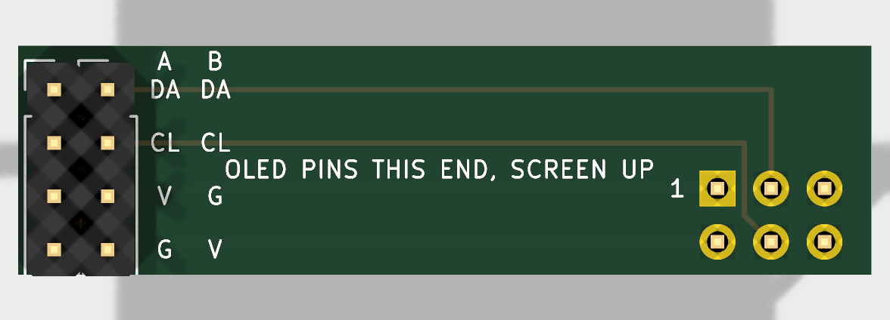

# Add-on packs: hardware

Plug-in boards for the watch's accessory socket. What the socket is and what it can do is in [docs/ADDONS.md](../../docs/ADDONS.md); this folder holds the boards and the plan for making packs cheaply.

**Status: sketch.** The Pack Base and Screen Pack boards below are designed and routed. Both pass KiCad's design-rule check (0 problems), their schematics pass the electrical-rule check, and their factory files are exported. Neither has been ordered, built or plugged into a watch.

| Folder / file | What it is |
|---|---|
| `pack_base/gen_pack_base.py` | Generates the Pack Base board, checks it, and with `--fab` exports the factory files |
| `pack_base/kicad/pack_base.kicad_pcb` | The board, placed and routed. Open it in KiCad 10 |
| `pack_base/gen_pack_base_sch.py` | Generates the schematic from the same parts table (any Python 3) |
| `pack_base/kicad/pack_base.kicad_sch` | The schematic: 0 electrical-rule findings, and its nets match the board's |
| `pack_base/fab/pack_base_gerbers.zip` | Upload this to the PCB factory |
| `pack_base/render_top.png`, `render_bottom.png` | Pictures of both sides |
| `screen_pack/gen_screen_pack.py`, `gen_screen_pack_sch.py` | The same for the Screen Pack (an OLED strip that lies on the lid). Reads its shared numbers from `enclosure/enclosure.scad` |
| `screen_pack/kicad/` | Its board and schematic |
| `screen_pack/fab/screen_pack_gerbers.zip` | Upload this to the PCB factory |
| `screen_pack/render_top.png`, `render_bottom.png` | Pictures of both sides |

## The idea: one board for every pack

Instead of a different board per pack, every pack is the same **Pack Base** with a cheap ready-made sensor board soldered on top. This keeps costs down three ways:

1. **One design, one order.** PCB factories charge per design. Five Pack Bases come in the same minimum order as one, so there is one order to pay for instead of one per pack.
2. **Order it in the same basket as the watch board,** so they ship together. Shipping usually costs more than the boards themselves.
3. **The sensors are mass-produced breakout boards** that cost little each (see the catalogue). Nothing on the Pack Base itself costs more than a few cents apart from the optional Qwiic socket.

It also makes the gift more versatile, because the Pack Base takes three kinds of add-on:

- **Breakout row (J2):** 6 holes in the order most cheap I²C boards use: `V G SCL SDA` and two spare holes. A GY-BME280 solders straight in, and its two extra pins land in the spare holes. BH1750, GY-521 (MPU6050) and most AHT20 boards start with the same 4 pins. Match the printed labels, not the pin count.
- **Microphone row (J3):** `G`, `X` (AUX) and `A` (AIN), for a MAX4466 or MAX9814 board. Power comes from AUX, so the microphone is off while the watch sleeps.
- **Qwiic / STEMMA QT socket (J5):** the 4-pin plug used by hundreds of SparkFun and Adafruit sensors, and by cheap copies of them. With it, a teacher can buy a new sensor later and plug it in with a cable, with no soldering. Several Qwiic sensors can chain one after another. Leave the socket off to save money; the board works without it.

Every I²C sensor shows up in Watch Studio's *Lab › Scan the socket* the moment it is plugged in, even before the firmware knows how to read it. That makes "what is on the bus?" a lesson on its own.

## The Pack Base board

20 × 18.6 mm, 2 layers, all through-hole except the optional Qwiic socket.

```
   top side, pack plugged in             underneath
   ┌──────── [Qwiic] ────────┐           ┌─────────────────────────┐
   │  V  G  CL DA  -  -      │  J2       │  "AWAY FROM DISPLAY"    │
   │ [3|·|X]            ○ G  │  JP1, J3  │                         │
   │                    ○ X  │           │   2x3 male header (J1)  │
   │      ● 1  ○ 3  ○ 5      │           │   plastic on this side  │
   └──────○ 2──○ 4──○ 6─○ A──┘           └─────────────────────────┘
          edge nearest the display
```

- **J1** is a standard straight 2×3 male header, plastic strip underneath, soldered on top. Its pins are exactly over the watch's socket. The generator checks this against the watch board's coordinates every time it runs.
- **The bottom edge is 1.3 mm below the lower pin row,** so the pack stops short of the display window (it starts 1.8 mm below). The rest of the board sticks out past the top edge of the watch.
- **JP1 sensor power:**
  - The pads come joined between `3` and the centre, so sensors are always powered from 3V3.
  - To power them only while the watch is awake, cut that join with a knife and put a blob of solder between the centre and `X` (AUX).
  - See *Battery life* below before relying on this.
- **Pin 1** has a square pad and a printed `1` on both sides, plus "PIN 1 = LID NOTCH" underneath.

To rebuild after a change:

```bash
"%LOCALAPPDATA%\Programs\KiCad\10.0\bin\python.exe" hardware/addons/pack_base/gen_pack_base.py --fab
```

It prints its placement checks and the design-rule result. It only writes the factory files when both are clean.

The schematic comes from the same parts table, so after changing a part's nets also run `python hardware/addons/pack_base/gen_pack_base_sch.py`.

### Ordering

Upload `pack_base/fab/pack_base_gerbers.zip`. The defaults are right: 2 layers, 1.6 mm, any colour, HASL (lead-free if offered). Add it to the same basket as the watch board.

The minimum order is usually 5 boards. For more, choose the factory's own panelising (at JLCPCB, "Panel by JLCPCB", 2 × 2) to get 4 boards per panel, which is 20 from the minimum order. Check what it adds to the price; it is usually small.

### Building a pack on it

1. Solder J1 (the 2×3 header) first: plastic underneath, solder on top, trim the pins flush on top.
2. Sensor board: push its own header pins through J2 from the top and solder underneath. Lay the sensor flat over the Pack Base, body towards the display end, with its header's plastic as the spacer. Do not stand it upright; that would make it very tall on a wrist.
3. Microphone board: same at J3, matching `G` / `X` / `A` to the board's GND / VCC / OUT.
4. Qwiic socket, if wanted: solder it last. It is surface-mount with pins 1 mm apart. That is doable with flux and a fine tip, or the PCB factory can fit it.
5. Before the first plug-in, measure resistance between J1 pins 1 and 2: it must not be near 0 Ω.

## The Screen Pack board

A strip that holds a 0.91" I²C OLED **flat on top of the watch**, along the edge above the 7-segment digits. It plugs straight down into the watch's accessory socket through the lid's opening, and the printed **screen clip** snaps over it to hold everything down. What the screen shows, and how teachers design their own screens, is in [docs/OLED_SCREENS.md](../../docs/OLED_SCREENS.md).

r2: 40.5 × 10.9 mm, 2 layers, all through-hole: one 2×3 header and two columns of holes for the module's own pins.

```
 seen from above, on the watch (the case's top edge is the dashed line)

   ┌─A─B────────────────────────────────────────┐   strip, overhanging the case edge
   │ ○ ○ DA DA                                   │
 - │ ○ ○ CL CL - - - - - - - - - - - - - - - - - │ - case edge
   │ ○ ○ V  G                     J1 underneath: │
   │ ○ ○ G  V                     ● ○ ○  in the  │
   └─────────────────────────────── ○ ○ ○ socket ┘
          the 7-segment display window starts 0.2 mm below this edge

   the OLED lies over the whole strip: pins on the left, glass facing up
```



- **Everything is mapped from one set of numbers.** The strip's outline, the module's size and where it sits are written once in [`enclosure/enclosure.scad`](../../enclosure/enclosure.scad) (the *Screen Pack r2* block). `gen_screen_pack.py` reads those lines to build the board, and the case model uses the same lines for the clip, the lid's pin pocket and the groove. Each side checks itself every time it runs:
  - the generator checks that J1's pins sit exactly over the watch's socket J4 (taken from the watch board's coordinates), that J1's plastic fits through the lid's opening with 0.2 mm to spare, that the strip stops short of the display window, that the module stays inside the lid's length in either column and stops 1.9 mm short of the digits, and that both columns have the right pin order;
  - `enclosure.scad` asserts that the strip and the pin pocket stay out of the display window, that the clip's leaves land on the flat part of the case wall, that the groove is shallow enough for the wall, and that the clip has a rim over both long edges of the module.
- **Two columns, because cheap OLED boards come with two pin orders.** Column A is for modules labelled `GND VCC SCL SDA` (most 0.91" boards), column B for `VCC GND SCL SDA`. Solder the module into the one column whose letters match its own. Column B is one pin pitch (2.54 mm) to the right, so the module simply sits 2.54 mm further right; the clip covers both positions.
- **Why on top, and not under the lid:** the lid's top strip is the only free surface the socket reaches. Under the lid along this edge are C1, C4 and the standing resistors R1–R8, R22 and R23, so the clip does not reach under the lid at all. It hooks the case's outer wall instead, into a groove in the base 6 mm below the lid seam.
- The OLED runs from the watch's 3V3. AUX and AIN (pins 5 and 6) are not connected.
- **Measured from photos, not from a module in hand.** The module's 38 × 12 mm outline is from sellers' drawings ([ProtoSupplies](https://protosupplies.com/product/oled-0-91-128x32-i2c-white-display/), [ThingBits](https://thingbits.in/products/0-91-inch-oled-128x32-display-board-with-i2c)). Its 2.7 mm thickness is DFRobot's figure for its DFR0648. The pin row's position (1.7 mm in from the left edge, centred across the width) and where the lit area sits were read off a seller's labelled photo. **Measure your module before ordering many**, then change the numbers in `enclosure.scad` and rebuild both: one edit moves the board and the clip together.
- A 0.96" 128×64 module is square, more than twice as tall as the 0.91" one, so it would cover the digits. It does not fit this strip. Use it on a cable with the Pack Base ([ADDONS.md](../../docs/ADDONS.md)).

To rebuild after a change (the board generator reads `enclosure.scad`, so re-export the STLs too):

```bash
"%LOCALAPPDATA%\Programs\KiCad\10.0\bin\python.exe" hardware/addons/screen_pack/gen_screen_pack.py --fab
python hardware/addons/screen_pack/gen_screen_pack_sch.py
openscad -D "part=\"screen_clip\"" -o enclosure/stl/screen_clip.stl enclosure/enclosure.scad
openscad -D "part=\"lid\""  -o enclosure/stl/lid.stl  enclosure/enclosure.scad
openscad -D "part=\"base\"" -o enclosure/stl/base.stl enclosure/enclosure.scad
```

`openscad -D "part=\"screen_assembly\"" enclosure/enclosure.scad` shows the strip, the module and the clip in place on the case.

Order it like the Pack Base: upload `screen_pack/fab/screen_pack_gerbers.zip` with the default settings, ideally in the same basket as the watch boards.

### Building it

You need the strip, a 0.91" OLED module (with the 4-pin male header it comes with), a 2×3 male header, and `enclosure/stl/screen_clip.stl` printed upside down (top on the bed, no supports, PETG). The case must be the current `base.stl` and `lid.stl`, which have the groove and the pin pocket.

1. **J1 first:** a 2×3 male header, plastic **underneath**, the long pins pointing down. Solder on top and trim flush: the module lies over these joints.
2. Read the four letters on your OLED's pins. They pick the column: **A** if the module reads `GND VCC SCL SDA`, **B** if `VCC GND SCL SDA`.
3. Solder the 4-pin header into the module first (sellers ship it loose). Then put its long pins down through that column, **glass facing up, pins at the left-hand end** (the silkscreen says so). The header's plastic sits on the strip and holds the module 2.5 mm above it.
4. Solder the four pins underneath and **trim them to about 1 mm**. They sit in a 1 mm pocket in the lid; longer stubs stop the strip lying flat.
5. Before the first plug-in, measure between J1 pins 1 and 2: it must not be near 0 Ω.
6. With the watch off, push J1 down into the socket through the lid's opening (pin 1, the square pad, goes to the notched corner). The strip lies flat on the lid, overhanging the top edge.
7. Snap the screen clip on from above: its two leaves slide down the outside of the case's top wall and click into the groove. To take it off, lever the leaves out with a fingernail.
8. If the picture is upside down, tick *OLED picture upside down* in Watch Studio's settings.
9. In the desk stand, stand the watch with the screen edge at the **top**: the clip sticks out 4.5 mm past the case and 8 mm above the lid, so it does not fit in the stand's trough.
4. Plug the OLED in, set *Settings › OLED screen* to its size, and press *Screens › Show the watch's OLED now*.

## Catalogue

"Works now" means the firmware already has a screen for it. "Scan only" means it shows up in Watch Studio's I²C scan, but it needs a small driver before the watch can display its readings. The price bands are rough guesses for cheap marketplace listings, not checked quotes, so compare before buying:

- **$**: under about $2
- **$$**: about $2–6
- **$$$**: $10 and up

| Pack | Module | Firmware | Cost | Good for |
|---|---|---|---|---|
| Environment | GY-BME280 (3.3 V version) | **Works now:** temperature, humidity, pressure, logging | $$ | Biology, environmental science, chemistry; pressure gives altitude, e.g. climbing stairs |
| Environment, no humidity | GY-BMP280 | **Works now:** temperature, pressure | $ | Same, cheaper. Many "BME280" listings actually ship this chip. The watch tells which one it is (no humidity screen) |
| Sound | MAX4466 board (MAX9814 also works) | **Works now:** tuner | $ | Music |
| Humidity, cheaper | AHT20 (often sold on one board with a BMP280) | Scan only (the BMP280 half works now) | $ | Environment pack at the lowest price. **Best next driver:** a few dozen lines |
| Light | BH1750 | Scan only | $ | Photosynthesis, inverse-square law. **Easy driver** |
| Motion | GY-521 (MPU6050); tie AD0 high, address `0x69` | Scan only | $ | Physics: pendulums, acceleration, step counting |
| Distance | VL53L0X | Scan only | $$ | Physics: motion graphs |
| Pulse | MAX30102 | Scan only. Clashes with the EEPROM on some clock modules | $$ | PE, biology: heart rate before and after exercise |
| Air quality | SCD40 (CO₂) | Scan only | $$$ | Chemistry, biology. Only if a teacher really wants it: it costs more than everything else here combined |
| Text display | SSD1306 0.91" OLED | Scan only | $ | Longer messages, labels for readings |
| Beeper | Passive piezo disc between AUX and GND | Needs firmware to drive AUX as a tone | $ | Audible timer alarms, metronome click, tuning reference. Idea only |

Which pack suits which teacher: see [docs/IDEAS.md](../../docs/IDEAS.md), and the ready-made [kits](../../kits/README.md).

## Keeping the cost down: recommendations

1. **Give every teacher a Pack Base with the Qwiic socket, plus one "works now" pack for their subject.** The Qwiic socket is what keeps the gift growing after it is handed over.
2. **Make packs a shared library, not one each.** Every watch has the same socket, so packs swap between watches. Buy one of each extra sensor and let teachers borrow, instead of buying every sensor for every watch.
3. **Start with modules the firmware already reads** (BME280/BMP280, MAX4466). Every other module also costs firmware time.
4. **Buy modules in 3- or 5-packs;** the price per board drops a lot. Spares cover any that arrive dead or are fakes.
5. **Next firmware drivers, in order of usefulness per cent:** AHT20 (cheapest humidity), then BH1750 (lux), then MPU6050 (motion).
6. **Perfboard is still free.** A Pack Base is neater and harder to get wrong, but a perfboard pack built to [docs/ADDONS.md](../../docs/ADDONS.md) › *Building a pack so it fits* works too.

## Battery life: watch out for power LEDs

The watch has a 150 mAh battery and sleeps on microamps. Many cheap breakout boards have an always-on power LED drawing 1–3 mA, which on the always-on supply would **flatten the watch in 2–6 days** even when it is not being used. Before fitting any module:

- **Best fix:** remove its power LED, or the LED's resistor (a hot iron and tweezers, or scrape it off with a knife). Then it can stay on 3V3.
- **JP1 set to AUX** turns the module off while the watch sleeps, but not completely. The watch's 4.7 kΩ I²C pull-ups stay powered and can feed a little current into an unpowered module through its data pins. A module left on AUX can still draw up to about 1 mA through its data pins.
- **Check every pack:** with the pack plugged in and the watch asleep (display dark), measure the battery current. A bare watch sleeps in microamps; anything over about 0.1 mA with the pack fitted needs one of the fixes above.

## Not done yet

- [ ] Order and build Screen Packs r2; measure a real 0.91" OLED module (outline, thickness, pin position) and check the strip and the screen clip on a printed case
- [ ] Order and build Pack Bases; check the fit on a printed case (header depth, edge clear of the display window)
- [ ] Measure sleep current with each module, on 3V3 and on AUX
- [ ] Firmware drivers: AHT20, BH1750, MPU6050, then the rest of the catalogue
- [ ] Piezo beeper on AUX: firmware tone output, check that the light sensor reading (which shares AUX) recovers afterwards
- [ ] A printed cap that covers a pack and keys it so it can only go in one way. The pack's direction already gives it away (backwards, it covers the display), but a cap would also protect the sensor
- [ ] Optional: a panel that puts a Pack Base in the corner of every watch-board order, once the watch board's routing is finished
